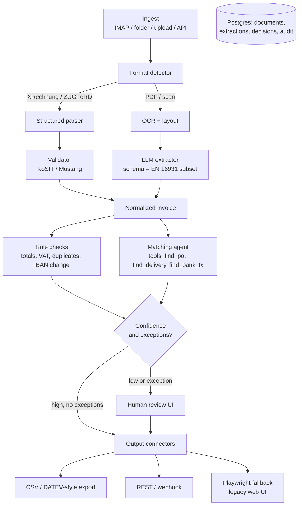

# Architecture — einvoice-agent

## 1. Goals / non-goals
**Goals:** deterministic where possible, LLM only where needed; every decision has a confidence and an explanation; human review is a first-class path.
**Non-goals (v1):** issuing invoices, GoBD-certified archiving, being a full ERP.

## 2. System overview


## 3. Components
| Component | Responsibility | Notes |
|---|---|---|
| Format detector | Identify UBL/CII XML, PDF/A-3 with embedded XML, text PDF, image | magic bytes + XML namespace |
| Structured parser | Map XML → `Invoice` Pydantic model | no LLM |
| Validator | Schematron/XSD validation, return rule violations | KoSIT/Mustang in sidecar container |
| LLM extractor | Vision LLM with JSON-schema output + per-field confidence; cross-checks (sum of lines = total) | only for non-structured docs |
| Rule checks | Deterministic business rules | each rule = small tested function |
| Matching agent | Tool-calling loop over ERP data: candidate search, scoring, explanation | bounded steps (max 8), read-only tools |
| Decision engine | Combine confidences + exceptions → auto / review | thresholds tuned on eval set |
| Review UI | Side-by-side doc + fields, highlight low confidence, approve/correct | corrections feed eval set |
| Connectors | Export / API / browser automation | Playwright runs only on allowlisted hosts, actions logged |

## 4. Core data model (draft)
```
Invoice(id, supplier{name, vat_id, iban}, buyer, number, date, due_date,
        currency, lines[{desc, qty, unit_price, vat_rate, net}], net_total,
        vat_total, gross_total, po_ref, source_format, field_confidence{})
Match(invoice_id, po_id, delivery_id, bank_tx_id, score, explanation)
Exception(invoice_id, type, severity, detail)
Decision(invoice_id, route[auto|review], reviewer, ts, changes{})
```

## 5. Design decisions (ADR log)
| # | Decision | Alternatives | Why |
|---|---|---|---|
| 1 | Structured-first, LLM fallback | LLM for everything | cheaper, exact, auditable |
| 2 | Agent only for matching | agent end-to-end | bounded, testable |
| 3 | Confidence thresholds tuned on eval | fixed 0.9 | trade auto-rate vs. errors explicitly |
| 4 | Playwright as last resort | RPA tools | open source, scriptable, testable vs. mock ERP |

## 6. Security & privacy
- Documents encrypted at rest; retention configurable
- Prompt-injection defense: invoice text treated as data; matching tools are read-only; writes only via connectors after decision
- IBAN-change detection as fraud signal (always review)

## 7. Repo layout
```
app/ (ingest, parse, validate, extract, checks, matching, decide, connectors)
ui/  mock_erp/  data/synthetic/  eval/  docs/adr/  deploy/
```

## 8. Open questions
- Which subset of EN 16931 fields matters most for small businesses?
- How to model partial deliveries / partial payments in matching?
