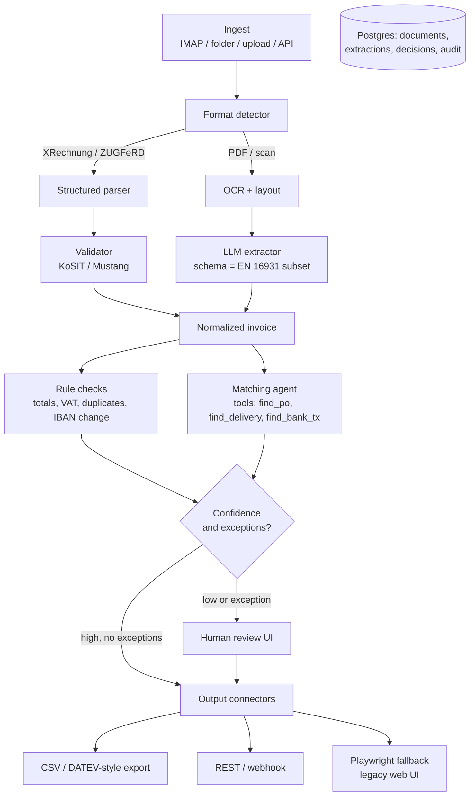

# Architecture — einvoice-agent

## 1. Goals / non-goals
**Goals:** deterministic where possible, LLM only where needed; every decision has a confidence and an explanation; human review is a first-class path.
**Non-goals (v1):** issuing invoices, GoBD-certified archiving, being a full ERP.

## 2. System overview


## 3. Components
| Component | Responsibility | Notes |
|---|---|---|
| Format detector | Identify UBL/CII XML, PDF/A-3 with embedded XML, text PDF, image | magic bytes + XML namespace |
| Structured parser | Map XML → `Invoice` Pydantic model | no LLM |
| Validator | Schematron/XSD validation, return rule violations | KoSIT/Mustang in sidecar container |
| LLM extractor | Vision LLM with JSON-schema output + per-field confidence; cross-checks (sum of lines = total) | only for non-structured docs |
| Rule checks | Deterministic business rules | each rule = small tested function |
| Matching agent | Tool-calling loop over ERP data: candidate search, scoring, explanation | bounded steps (max 8), read-only tools |
| Decision engine | Combine confidences + exceptions → auto / review | thresholds tuned on eval set |
| Review UI | Side-by-side doc + fields, highlight low confidence, approve/correct | corrections feed eval set |
| Connectors | Export / API / browser automation | Playwright runs only on allowlisted hosts, actions logged |

## 4. Core data model (draft)
```
Invoice(id, supplier{name, vat_id, iban}, buyer, number, date, due_date,
        currency, lines[{desc, qty, unit_price, vat_rate, net}], net_total,
        vat_total, gross_total, po_ref, source_format, field_confidence{})
Match(invoice_id, po_id, delivery_id, bank_tx_id, score, explanation)
Exception(invoice_id, type, severity, detail)
Decision(invoice_id, route[auto|review], reviewer, ts, changes{})
```

## 5. Design decisions (ADR log)
Rows 1–4 were set before building; D1–D11 were taken while building, and the eval report and code
comments refer to them by these numbers. A decision that replaced another says so; none is deleted.

| # | Decision | Alternatives | Why |
|---|---|---|---|
| 1 | Structured-first, LLM fallback | LLM for everything | cheaper, exact, auditable |
| 2 | Agent only for matching _(superseded by D11: no agent is built)_ | agent end-to-end | bounded, testable |
| 3 | Confidence thresholds tuned on eval | fixed 0.9 | trade auto-rate vs. errors explicitly |
| 4 | Playwright as last resort | RPA tools | open source, scriptable, testable vs. mock ERP |
| D1 | Python 3.12 with uv; one package `app/` with FastAPI, Pydantic v2, SQLAlchemy 2 + Alembic, pytest, ruff; review UI in `ui/` with pnpm | Poetry/pip; Django; one repo per part | tooling already on the development machine; one package keeps pipeline, API and eval importing the same code |
| D2 | Java only in a container: the KoSIT validator runs as a `validator` sidecar | a local JRE; Mustang in-process | the host needs only Docker and uv. Mustang is not in the container yet, so ZUGFeRD profiles outside EN 16931 and PDF/A-3 conformance are not validated |
| D3 | The pipeline is a plain function, `process_document(data, validator, extractor)`, made of pure steps; the queue only wraps it | pipeline built on the queue framework | testable without infrastructure; the eval runs the same function as the worker |
| D4 | Queue: RQ on Redis | Celery | the smallest thing that works; Celery's routing, beat and result backends are not needed |
| D5 | Field confidence is computed, not asked of the model: checks (IBAN mod-97, VAT ID shape, arithmetic) and grounding (value found in the PDF text or OCR), mapped to a probability by a table fitted on the dev split | the model's self-reported confidence | self-reported confidence is poorly calibrated, and the threshold (3) needs a number that means something. Agreement across repeated runs was planned and not built (paid reruns). Known blind spot: a right value in the wrong field (eval report, worst cases 1–2) |
| D6 | Matching is deterministic candidate search and scoring first; an agent only for what remains _(remainder superseded by D11)_ | agent for every invoice | most invoices quote an order; the rule-based matcher is also the eval's baseline to beat |
| D7 | A match is a set of allocations (invoice → order, delivery, payment, each with an amount), not one row with one order, delivery and transfer | the 1:1:1:1 `Match` drafted in §4 | partial deliveries, instalments and one transfer paying several invoices cannot be expressed otherwise. Answers open question §8.2 |
| D8 | v1 models a field subset of EN 16931: number, dates, type, currency, buyer reference, order reference, seller and buyer name and VAT ID, IBAN, totals, VAT breakdown, line id, quantity, unit price, net, VAT rate, description | all of EN 16931 | exactly what booking, the checks and the matcher use; everything else stays in the original document. Answers open question §8.1 |
| D9 | Credit notes (381) and other document types are parsed but always go to review, and are never delivered to a connector | book them with a negative sign | sign handling in matching and booking is a project of its own; a credit note booked as an invoice is worse than asking |
| D10 | Parsers are tested against the official XRechnung test suite and ZUGFeRD sample files, not only the project's own generator | generator only | "ground truth by construction" is circular when generator and parser share one author's reading of the standard |
| D11 | No model-based matching agent in v1: the rule-based matcher decides what it can and leaves the rest open for a person | a tool-calling agent for the remainder (2, D6) | on the eval world the rules reach 100 % on the held-out split and 99.5 % on seeds never looked at, with no wrong link; what remains is undecidable for any reader. An agent would add cost and a place for injected text to act. Revisit with real data or a harder world |

## 6. Security & privacy
- Documents encrypted at rest; retention configurable
- Prompt-injection defense: invoice text treated as data; matching tools are read-only; writes only via connectors after decision
- IBAN-change detection as fraud signal (always review)

## 7. Repo layout
```
app/ (ingest, parse, validate, extract, checks, matching, decide, connectors)
ui/  mock_erp/  data/synthetic/  eval/  docs/adr/  deploy/
```

## 8. Open questions
- Which subset of EN 16931 fields matters most for small businesses?
- How to model partial deliveries / partial payments in matching?
