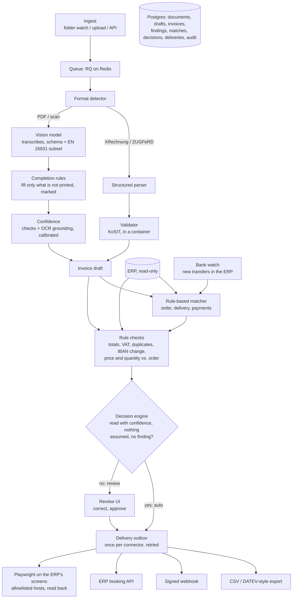

# Architecture — einvoice-agent

## 1. Goals / non-goals
**Goals:** deterministic where possible, LLM only where needed; every decision has a confidence and an explanation; human review is a first-class path.
**Non-goals (v1):** issuing invoices, GoBD-certified archiving, being a full ERP.

## 2. System overview
As built (v0.5). Planned parts that are not built are listed under the diagram.



Planned and not built: IMAP ingest (v1.0), a model-based matching agent (dropped, D11), Mustang
validation of ZUGFeRD profiles outside EN 16931 and of PDF/A-3 (D2), a local vision model behind the
extractor interface.

## 3. Components
| Component | Responsibility | Where | Notes |
|---|---|---|---|
| Ingest | Take files from a watched folder, the review UI's upload or `POST /documents`; deduplicate by SHA-256 | `app/ingest.py`, `app/api` | IMAP not built |
| Worker | Run the pipeline for each document off the queue; every 2 minutes, queue again any document stuck in "received" for 15 minutes with no job waiting or running | `app/worker.py`, `app/pipeline` | the pipeline is a plain function (D3); RQ only wraps it (D4); one job per document at a time |
| Format detector | Identify UBL/CII XML, PDF/A-3 with embedded XML, text PDF, image | `app/detect` | magic bytes + XML namespace |
| Structured parser | Map XML → `Invoice` Pydantic model | `app/parse` | no model; hardened XML parsing (`app/safe_xml.py`: no entities, DTDs or network) |
| Validator | Schematron/XSD validation, return rule violations | `app/validate`, `deploy/validator` | KoSIT in a sidecar container (D2) |
| Extractor | Vision model with JSON-schema output; transcribes only, never calculates | `app/extract` | Anthropic API by default; `EXTRACTOR=baseline` (rules over text/OCR) or `none` keeps documents local |
| Completion rules | Fill a VAT total from the groups and an absent currency (EUR); mark what was filled | `app/extract/complete.py` | an assumed value always goes to review |
| Confidence | Per field: checks (IBAN mod-97, VAT ID, arithmetic) and grounding in the PDF text or OCR, mapped by a table fitted on the dev split | `app/extract/confidence.py` | D5; computed, not asked of the model |
| Matching | Find order, delivery and payments: references, typos, line content, amounts, instalments, combined transfers; "ambiguous" instead of a guess | `app/matching` | rules only (D11); allocations (D7); ERP read over HTTP (`app/erp`) |
| Re-matching | Match open invoices again when a new invoice or a new bank transfer arrives | `app/rematch.py`, `app/watch.py` | amount-only payments stay provisional; one bank watch per database, enforced by a Postgres advisory lock (`app/db/instance_lock.py`) |
| Rule checks | Deterministic business rules, each a small tested function | `app/checks` | findings with severity; compared with the ERP's supplier and order |
| Decision engine | Combine confidence, assumed values and findings → auto / review, with every reason | `app/decide` | threshold fitted on the eval set (3); version stored with each decision |
| Review UI | Document beside its fields, unsure fields marked, why it needs a person, correct, approve, history, delivery status | `ui/` (Next.js) | corrections are kept as future eval cases in `data/private/feedback/` (outside git) |
| Delivery outbox | Deliver approved or auto-decided invoices once per connector; frozen booking, idempotency key, backoff | `app/delivery.py`, `app/deliver.py` | only type 380 (D9); one delivery loop per database, enforced like the bank watch |
| Connectors | CSV/DATEV-style export, signed webhook, ERP booking API, ERP screens with a browser | `app/connectors` | the browser runs only on allowlisted hosts, logs every action, reads every booking back (4) |
| Mock ERP | Suppliers, orders, deliveries, bank transfers, bookings; API and German HTML screens | `mock_erp/` | the eval world's data; seeds itself in Docker |
| Matching agent | _Planned: tool-calling loop over ERP data for what the rules leave open_ | – | not built (D11) |

## 4. Core data model
Postgres tables (`app/db/tables.py`, migrations in `migrations/`):

```
documents(id, sha256, filename, format, status, error, content, review_state, created_at)
drafts(document_id, original, data, updated_at)   # what was read, and with the reviewer's corrections
invoices(document_id, number, issue_date, seller_name, seller_vat_id, currency,
         gross_total, data)                       # the invoice of record: parsed, or approved
validation_results(document_id, valid, scenario, violations, created_at)
findings(document_id, position, type, severity, message, fields, detail)
matches(document_id, supplier_id, po_number, po_basis, delivery_id,
        payments[{bank_transaction_id, amount}], payment_basis, explanation)   # allocations, D7
decisions(document_id, route[auto|review], reasons, version, decided_at)
deliveries(document_id, connector, idempotency_key, status, booking, attempts,
           next_attempt_at, external_ref, last_error, created_at, delivered_at)
audit_events(seq, document_id, event, actor, detail, created_at)
seen_bank_transactions(id, booking_date, seen_at)  # what the bank watch has already handled
```

The invoice itself (`app/models/invoice.py`) is the EN 16931 subset of D8, with per-field confidence.
What was read but not yet approved is an `InvoiceDraft` (`app/extract/draft.py`): any field may be
missing, and `derived_fields` names what the completion rules filled in. The first draft of this section had one `Match` row
with one order, delivery and transfer; D7 replaced it.

## 5. Design decisions (ADR log)
Rows 1–4 were set before building; D1–D11 were taken while building, and the eval report and code
comments refer to them by these numbers. A decision that replaced another says so; none is deleted.

| # | Decision | Alternatives | Why |
|---|---|---|---|
| 1 | Structured-first, LLM fallback | LLM for everything | cheaper, exact, auditable |
| 2 | Agent only for matching _(superseded by D11: no agent is built)_ | agent end-to-end | bounded, testable |
| 3 | Confidence thresholds tuned on eval | fixed 0.9 | trade auto-rate vs. errors explicitly |
| 4 | Playwright as last resort | RPA tools | open source, scriptable, testable vs. mock ERP |
| D1 | Python 3.12 with uv; one package `app/` with FastAPI, Pydantic v2, SQLAlchemy 2 + Alembic, pytest, ruff; review UI in `ui/` with pnpm | Poetry/pip; Django; one repo per part | tooling already on the development machine; one package keeps pipeline, API and eval importing the same code |
| D2 | Java only in a container: the KoSIT validator runs as a `validator` sidecar | a local JRE; Mustang in-process | the host needs only Docker and uv. Mustang is not in the container yet, so ZUGFeRD profiles outside EN 16931 and PDF/A-3 conformance are not validated |
| D3 | The pipeline is a plain function, `process_document(data, validator, extractor)`, made of pure steps; the queue only wraps it | pipeline built on the queue framework | testable without infrastructure; the eval runs the same function as the worker |
| D4 | Queue: RQ on Redis | Celery | the smallest thing that works; Celery's routing, beat and result backends are not needed |
| D5 | Field confidence is computed, not asked of the model: checks (IBAN mod-97, VAT ID shape, arithmetic) and grounding (value found in the PDF text or OCR), mapped to a probability by a table fitted on the dev split | the model's self-reported confidence | self-reported confidence is poorly calibrated, and the threshold (3) needs a number that means something. Agreement across repeated runs was planned and not built (paid reruns). Known blind spot: a right value in the wrong field (eval report, worst cases 1–2) |
| D6 | Matching is deterministic candidate search and scoring first; an agent only for what remains _(remainder superseded by D11)_ | agent for every invoice | most invoices quote an order; the rule-based matcher is also the eval's baseline to beat |
| D7 | A match is a set of allocations (invoice → order, delivery, payment, each with an amount), not one row with one order, delivery and transfer | the 1:1:1:1 `Match` drafted in §4 | partial deliveries, instalments and one transfer paying several invoices cannot be expressed otherwise. Answers open question §8.2 |
| D8 | v1 models a field subset of EN 16931: number, dates, type, currency, buyer reference, order reference, seller and buyer name and VAT ID, IBAN, totals, VAT breakdown, line id, quantity, unit price, net, VAT rate, description | all of EN 16931 | exactly what booking, the checks and the matcher use; everything else stays in the original document. Answers open question §8.1 |
| D9 | Credit notes (381) and other document types are parsed but always go to review, and are never delivered to a connector | book them with a negative sign | sign handling in matching and booking is a project of its own; a credit note booked as an invoice is worse than asking |
| D10 | Parsers are tested against the official XRechnung test suite and ZUGFeRD sample files, not only the project's own generator | generator only | "ground truth by construction" is circular when generator and parser share one author's reading of the standard |
| D11 | No model-based matching agent in v1: the rule-based matcher decides what it can and leaves the rest open for a person | a tool-calling agent for the remainder (2, D6) | on the eval world the rules reach 100 % on the held-out split and 99.5 % on seeds never looked at, with no wrong link; what remains is undecidable for any reader. An agent would add cost and a place for injected text to act. Revisit with real data or a harder world |

## 6. Security & privacy
Built and tested:
- **Invoice content is data.** The extraction prompt says so; matching, checks and the decision use no
  model, so injected text can act only through extracted fields, which the checks compare with the
  ERP. 20 injection probes, 0 changed a field, a route or a match (`make eval-probes`, in CI).
- **Writes only through connectors, only after a decision** (auto or a person's approval), each
  invoice once per connector.
- **A changed bank account always goes to review** (fraud signal), as does anything assumed.
- **Browser connector**: allowlisted hosts only; every request outside them is blocked, logged and
  fails the delivery; every action is logged, failures leave a screenshot.
- **Webhook**: HMAC-SHA256 over timestamp and body; HTTPS only except to localhost; no redirects.
- **XML**: no entity expansion, DTD loading or network access.
- **Secrets** only in `.env` (ignored by git and the Docker build).
- **Data in git**: synthetic only; real invoice data (`data/private/`, browser logs in `data/browser/`)
  is ignored.

Not built:
- **No authentication.** The API and UI are meant for localhost; the reviewer's name in the audit trail
  comes from the UI and is not verified.
- **No encryption at rest and no retention settings.** Planned here originally; deferred because it
  needs a key-management decision first.
- **PDFs and scans leave the machine** for the Anthropic API unless `EXTRACTOR=baseline` or `none`.

## 7. Repo layout
```
app/       ingest, detect, parse, validate, extract, checks, matching, decide,
           delivery + connectors, api, worker, watch, db
ui/        review UI (Next.js) and its browser tests
mock_erp/  the mock ERP: API, HTML screens, seed
eval/      generators, runners, scorers, report, recordings of model answers
tests/     unit and integration tests, third-party sample files (D10)
deploy/    Dockerfiles (app, UI, validator) and the full-stack check
docs/      eval-report.md
migrations/, sample_invoices/, data/ (local only: private data, mock ERP, logs)
```

## 8. Open questions
- ~~Which subset of EN 16931 fields matters most for small businesses?~~ Answered for v1 by D8.
- ~~How to model partial deliveries / partial payments in matching?~~ Answered by D7.
- Is EUR the right default for an invoice that prints no currency? Assumed, and always sent to review;
  not yet confirmed.
- What second, independent confidence signal would catch a right value read into the wrong field
  (eval report, worst cases 1–2)? Agreement across repeated runs is the candidate (D5).
- How do the numbers hold on real, anonymized invoices and a real ERP's data?
- Which key management for encryption at rest?
