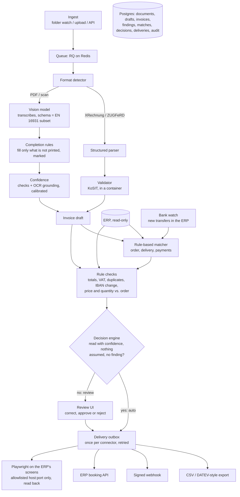

# Architecture — einvoice-agent

## 1. Goals / non-goals
**Goals:** deterministic where possible, LLM only where needed; every decision has a confidence and an explanation; human review is a first-class path.
**Non-goals (v1):** issuing invoices, GoBD-certified archiving, being a full ERP.

## 2. System overview
As built (v0.5). Planned parts that are not built are listed under the diagram.



Planned and not built: IMAP ingest (v1.0), a model-based matching agent (dropped, D11), Mustang
validation of ZUGFeRD profiles outside EN 16931 and of PDF/A-3 (D2), a local vision model behind the
extractor interface.

## 3. Components
| Component | Responsibility | Where | Notes |
|---|---|---|---|
| Ingest | Take files from a watched folder, the review UI's upload or `POST /documents`; deduplicate by SHA-256 | `app/ingest.py`, `app/api` | IMAP not built |
| Worker | Run the pipeline for each document off the queue; every 2 minutes, queue again any document stuck in "received" for 15 minutes with no job waiting or running | `app/worker.py`, `app/pipeline` | the pipeline is a plain function (D3); RQ only wraps it (D4); one job per document at a time |
| Format detector | Identify UBL/CII XML, PDF/A-3 with embedded XML, text PDF, image | `app/detect` | magic bytes + XML namespace |
| Structured parser | Map XML → `Invoice` Pydantic model | `app/parse` | no model; hardened XML parsing (`app/safe_xml.py`: no entities, DTDs or network) |
| Validator | Schematron/XSD validation, return rule violations | `app/validate`, `deploy/validator` | KoSIT in a sidecar container (D2) |
| Extractor | Vision model with JSON-schema output; transcribes only, never calculates | `app/extract` | Anthropic API by default; `EXTRACTOR=baseline` (rules over text/OCR) or `none` keeps documents local; a PDF over `MAX_PAGES` (10) is not read and goes to a person |
| Completion rules | Fill a VAT total from the groups and an absent currency (EUR); mark what was filled | `app/extract/complete.py` | an assumed value always goes to review |
| Confidence | Per field: checks (IBAN mod-97, VAT ID, arithmetic) and grounding in the PDF text or OCR, mapped by a table fitted on the dev split | `app/extract/confidence.py` | D5; computed, not asked of the model |
| Matching | Find order, delivery and payments: references, typos, line content, amounts, instalments, combined transfers; "ambiguous" instead of a guess | `app/matching` | rules only (D11); allocations (D7); ERP read over HTTP (`app/erp`) |
| Re-matching | Match open invoices again when a new invoice or a new bank transfer arrives | `app/rematch.py`, `app/watch.py` | amount-only payments stay provisional; one bank watch per database, enforced by a Postgres advisory lock (`app/db/instance_lock.py`) |
| Rule checks | Deterministic business rules, each a small tested function | `app/checks` | findings with severity; compared with the ERP's supplier and order |
| Decision engine | Combine confidence, assumed values, values printed but not read (Leitweg-ID, IBAN, German VAT ID with valid check digits) and findings → auto / review, with every reason | `app/decide` | threshold fitted on the eval set (3); version stored with each decision |
| Review UI | Document beside its fields, unsure fields marked, why it needs a person, correct, approve, reject with a reason (never delivered, checked again or matched to payments unless reopened with a note), reject plain duplicates together (`app/db/duplicates.py`), history, delivery status | `ui/` (Next.js) | corrections are kept as future eval cases in `data/private/feedback/` (outside git) |
| Delivery outbox | Deliver approved or auto-decided invoices once per connector; frozen booking, idempotency key, backoff | `app/delivery.py`, `app/deliver.py` | only type 380 (D9); one delivery loop per database, enforced like the bank watch |
| Connectors | CSV/DATEV-style export, signed webhook, ERP booking API, ERP screens with a browser | `app/connectors` | the browser runs only on allowlisted host and port, logs every action, reads every booking back (4) |
| Mock ERP | Suppliers, orders, deliveries, bank transfers, bookings; API and German HTML screens | `mock_erp/` | the eval world's data; seeds itself in Docker |
| Matching agent | _Planned: tool-calling loop over ERP data for what the rules leave open_ | – | not built (D11) |

## 4. Core data model
Postgres tables (`app/db/tables.py`, migrations in `migrations/`):

```
tenants(id, slug, name, created_at)               # the companies one installation serves
documents(id, tenant_id, sha256, filename, format, status, error, content, review_state,
          created_at)                             # sha256 unique per tenant
drafts(document_id, original, data, updated_at)   # what was read, and with the reviewer's corrections
invoices(document_id, number, issue_date, seller_name, seller_vat_id, currency,
         gross_total, data)                       # the invoice of record: parsed, or approved
validation_results(document_id, valid, scenario, violations, created_at)
findings(document_id, position, type, severity, message, fields, detail)
matches(document_id, supplier_id, po_number, po_basis, delivery_id,
        payments[{bank_transaction_id, amount}], payment_basis, explanation)   # allocations, D7
decisions(document_id, route[auto|review], reasons, version, decided_at)
deliveries(document_id, connector, idempotency_key, status, booking, attempts,
           next_attempt_at, external_ref, last_error, created_at, delivered_at)
audit_events(seq, document_id, event, actor, actor_user_id, detail, created_at)
seen_bank_transactions(tenant_id, id, booking_date, seen_at)  # what the bank watch has handled
users(id, email, display_name, password_hash, disabled, oidc_issuer, oidc_subject, created_at)
memberships(user_id, tenant_id, role)             # a person's role in each company
api_tokens(id, user_id, tenant_id, name, token_hash, ...)   # a token acts in one tenant
sessions(id_hash, user_id, tenant_id, expires_at, ...)     # the tenant a person works in
```

**Tenants (v1.0 Stage 2).** Every document belongs to one tenant; the rows hanging off a document
(drafts, findings, matches, decisions, deliveries, audit events) are reached only through it. Each
request acts for one tenant (the session's or the token's), and every query, the duplicate check and
payment matching see only that tenant: another tenant's document is a 404.

**Each tenant's settings** (`app/tenants.py`, table `tenant_settings`): its ERP (matching, bank watch,
booking through the API or the screens), CSV export folder, webhook, page limit, and whether an order
found by content alone may be booked on. The default tenant without a row keeps using `.env`, so a
one-company installation runs unchanged. Secrets are never stored there: a tenant names the
environment variable that holds its webhook secret (`webhook_secret_env`, `TENANT_…`), and the value
stays in `.env` until Stage 6 brings encryption at rest. The model and its calibrated threshold stay
installation-wide. `einvoice tenant-add`, `tenant-set`, `tenant-show` manage them; the worker, API,
bank watch and delivery loop build each tenant's checker and connectors from them, and one tenant's
broken settings (a missing secret) only stop that tenant's deliveries.

**Mailbox** (`app/mailbox.py`, the `mailbox` service; v1.0 Stage 3). A tenant whose settings name an
IMAP mailbox (operator-level: host, port, TLS, user, the password's variable, folder, where handled
mail goes) has it read every `MAILBOX_SECONDS`. Each attached invoice (XML, PDF, attached images; also
inside forwarded mails) goes through `ingest` for the tenant, with sender, subject and Message-ID in its
history as where it came from — data, never instructions. Per tenant and mailbox folder the
`UIDVALIDITY` and the last UID handled are kept (`mailbox_state`, with RLS) and advanced mail by mail:
a restart loses and duplicates nothing, and a mail read twice adds no document (`ingest` knows the
bytes). A handled mail is flagged (`\Seen $EInvoiceDone`) or moved, never deleted; mails are read
with `BODY.PEEK`. Plain IMAP without TLS only to this machine. Tested against a fake mailbox and
against GreenMail in Docker (`make test-mailbox`, also in CI).
Every mail read is kept (`mails`, with RLS), in the same transaction as its UID, with what became of
each attached file: stored as an invoice, already known, or refused with a reason — too large, empty,
not an invoice format, a PDF or ZIP behind a password, a ZIP inside a ZIP, a ZIP with too many files,
a ZIP bomb (unpacks to over 100 times its packed size), unreadable. ZIPs are opened in memory one
level deep, every member read with the size limit rather than trusting the ZIP's own sizes. A mail
with nothing attached is kept too. The review UI lists them on its Mail page.
Signing in: a password, or OAuth2 (XOAUTH2, `app/mailbox_oauth.py`) — Microsoft 365 with the
client-credentials grant (the app signs in as itself), Gmail with a refresh token from a one-time
consent; a token is reused until two minutes before it expires. Client secrets and refresh tokens are
named `TENANT_…` variables like every secret, and appear in no log or error. Where the server offers
SASL-IR the token goes with the AUTHENTICATE command. The mailbox eval (`make eval-mailbox`, 200
synthetic mails, with crashes; also through GreenMail) gates this in CI.

**Languages** (v1.0 Stage 4). The review UI speaks German and English: every text it has of its
own is in `ui/lib/messages.ts`, where the German catalogue is typed against the English keys, so a
missing translation does not build. The language comes from the browser, can be switched in the
masthead and is remembered in the browser; someone signed in has their choice kept with their account
too (`users.language`, `POST /auth/language`, in `/auth/me`), and it wins over the browser's once they
sign in, in any browser. Amounts are formatted `de-DE` or `en-GB` from their decimal
string, never through a float (`Intl.NumberFormat` takes the string exactly). The fields of the review form show
amounts the same way, without grouping ("7864,76"): `i18n.decimal` swaps the point for a comma in the
string, and a language switch rewrites what is in the form, edits included. What a reviewer types is
read in either notation (the last of comma and point is the decimal sign: "1.234,56", "1,234.56"). Texts the server writes —
findings, decision reasons, match explanations, re-match triggers, delivery errors — are `Text`s
(`app/texts.py`): a `str` that is the English sentence, as before, and also carries a code and
parameters. They are stored next to the sentence (`findings.text`, `matches.explanation_texts`,
`deliveries.error_text`, a `text` in each decision reason and `trigger_text` in the history) and the UI
renders them in its language (`server.<code>` in the catalogues), falling back to the English sentence. Rows
stored before codes existed get them with `einvoice texts-backfill [--apply]` (`app/texts_backfill.py`):
each English template is matched against the stored sentence, and a code is kept only when the `Text`
made from it is exactly that sentence again; the history (`audit_events`) is not rewritten.
Parameters named `…_amount`, `…_percent` and `fields` are formatted by the UI (amounts, shares, field
labels). `tests/test_texts.py` fails if a code lacks a German or English text or if their parameters
differ. The API's refusals work the same way: an `HTTPException` whose detail is a `Text` is answered
with `detail` (the English sentence, as every client got before) and `text` (its code); review actions
and member changes raise Texts too, and the UI shows any refusal through `i18n.error()` in its
language, as it does its own "API not reachable". A note the server writes on a rejection (a copy
rejected with "reject all duplicates") keeps its code as `note_text` in the history. The browser suites
run once per language (`E2E_LANGUAGE=de`; `make ui-test` runs both), taking every text they look for
from the same catalogues; the German run also scans each rendered page for English
(`ui/e2e/language.ts`: phrases of the English catalogue German does not share, and English function
words), and the English run checks that this scan finds English where there is some. The German terms follow
a glossary of accounts-payable usage (Beleg, Freigabe, Lieferant, Bestellung, Wareneingang, USt-IdNr.,
formal "Sie", …) in `ui/scripts/german-texts.mjs`; `make ui-build` (and so CI) fails on a word it rules
out, and on a stale `docs/german-texts.md`, the list of every German text next to its English that a
native speaker reads through (`make german-texts` writes it).

**Admin page** (`/admin`, the tenant's admins). Members: add (someone new signs in through the
identity provider; someone from another tenant gets a role here too), change role, remove (their
sessions and tokens here stop at once); nobody can demote or remove themselves, and a tenant is never
left without an admin. Settings: the page limit and the decision setting. Everything that reaches the
server's network or files (ERP, folders, browser allowlist, webhook and its secret's name) and creating
tenants stay with the installation's operator and the CLI; the page only shows them (owner's decision,
2026-11-20). A person in several tenants switches in the masthead (`POST /auth/tenant`, browser
sessions only: a token acts in the tenant it was made for). The admin routes read the account tables
in a transaction of their own, filtered by the admin's tenant in the code: the request's own
transaction runs as the tenant role, which cannot read them.

**Row-level security.** Postgres keeps the tenants apart as well (`app/db/rls.py`). A request's
transaction switches to the role `einvoice_tenant` (no login, no BYPASSRLS) and sets
`app.tenant_id`, both only until the transaction ends. Policies on `documents` and
`seen_bank_transactions` compare `tenant_id`; the tables hanging off a document are visible where their
document is. The role may change only those tables and cannot read users, memberships, tokens or
sessions. Background work runs the same way, one tenant at a time: the worker first asks, as the login
role, whose the queued document is, then does everything else acting for that tenant; the folder watch
and the CLI's `process`, `watch`, `user-add` and `token-create` take `--tenant`; the bank watch and the
delivery loop go tenant by tenant, each with its own ERP and connectors. Only the
look-ups that must see across tenants run as the login role: whose a document is, the sweep for lost
jobs, the sign-in tables, migrations. New tables that hold tenant data need their grant and policy in
their migration.

The invoice itself (`app/models/invoice.py`) is the EN 16931 subset of D8, with per-field confidence.
What was read but not yet approved is an `InvoiceDraft` (`app/extract/draft.py`): any field may be
missing, and `derived_fields` names what the completion rules filled in. The first draft of this section had one `Match` row
with one order, delivery and transfer; D7 replaced it.

## 5. Design decisions (ADR log)
Rows 1–4 were set before building; D1–D11 were taken while building, and the eval report and code
comments refer to them by these numbers. A decision that replaced another says so; none is deleted.

| # | Decision | Alternatives | Why |
|---|---|---|---|
| 1 | Structured-first, LLM fallback | LLM for everything | cheaper, exact, auditable |
| 2 | Agent only for matching _(superseded by D11: no agent is built)_ | agent end-to-end | bounded, testable |
| 3 | Confidence thresholds tuned on eval | fixed 0.9 | trade auto-rate vs. errors explicitly |
| 4 | Playwright as last resort | RPA tools | open source, scriptable, testable vs. mock ERP |
| D1 | Python 3.12 with uv; one package `app/` with FastAPI, Pydantic v2, SQLAlchemy 2 + Alembic, pytest, ruff; review UI in `ui/` with pnpm | Poetry/pip; Django; one repo per part | tooling already on the development machine; one package keeps pipeline, API and eval importing the same code |
| D2 | Java only in a container: the KoSIT validator runs as a `validator` sidecar | a local JRE; Mustang in-process | the host needs only Docker and uv. Mustang is not in the container yet, so ZUGFeRD profiles outside EN 16931 and PDF/A-3 conformance are not validated |
| D3 | The pipeline is a plain function, `process_document(data, validator, extractor)`, made of pure steps; the queue only wraps it | pipeline built on the queue framework | testable without infrastructure; the eval runs the same function as the worker |
| D4 | Queue: RQ on Redis | Celery | the smallest thing that works; Celery's routing, beat and result backends are not needed |
| D5 | Field confidence is computed, not asked of the model: checks (IBAN mod-97, VAT ID shape, arithmetic) and grounding (value found in the PDF text or OCR), mapped to a probability by a table fitted on the dev split | the model's self-reported confidence | self-reported confidence is poorly calibrated, and the threshold (3) needs a number that means something. Agreement across repeated runs was planned and not built (paid reruns). Known blind spot: a right value in the wrong field (eval report, worst cases 1–2) |
| D6 | Matching is deterministic candidate search and scoring first; an agent only for what remains _(remainder superseded by D11)_ | agent for every invoice | most invoices quote an order; the rule-based matcher is also the eval's baseline to beat |
| D7 | A match is a set of allocations (invoice → order, delivery, payment, each with an amount), not one row with one order, delivery and transfer | the 1:1:1:1 `Match` drafted in §4 | partial deliveries, instalments and one transfer paying several invoices cannot be expressed otherwise. Answers open question §8.2 |
| D8 | v1 models a field subset of EN 16931: number, dates, type, currency, buyer reference, order reference, seller and buyer name and VAT ID, IBAN, totals, VAT breakdown, line id, quantity, unit price, net, VAT rate, description | all of EN 16931 | exactly what booking, the checks and the matcher use; everything else stays in the original document. Answers open question §8.1 |
| D9 | Credit notes (381) and other document types are parsed but always go to review, and are never delivered to a connector | book them with a negative sign | sign handling in matching and booking is a project of its own; a credit note booked as an invoice is worse than asking |
| D10 | Parsers are tested against the official XRechnung test suite and ZUGFeRD sample files, not only the project's own generator | generator only | "ground truth by construction" is circular when generator and parser share one author's reading of the standard |
| D11 | No model-based matching agent in v1: the rule-based matcher decides what it can and leaves the rest open for a person | a tool-calling agent for the remainder (2, D6) | on the eval world the rules reach 100 % on the held-out split and 99.5 % on seeds never looked at, with no wrong link; what remains is undecidable for any reader. An agent would add cost and a place for injected text to act. Revisit with real data or a harder world |
| D12 | An invoice that prints no currency is read as EUR (confirmed by the project owner, 2026-11-15). The value is marked as assumed and the invoice goes to a person | leave the currency empty and refuse; ask the model to infer it from the country | German invoices without a currency sign are EUR in practice; an assumption stays visible and reviewed instead of passing as a reading (`app/extract/complete.py`). Review kept after the confirmation (2026-11-15): on dev it held back two misread scans that confidence missed |

## 6. Security & privacy
Built and tested:
- **Invoice content is data.** The extraction prompt says so; matching, checks and the decision use no
  model, so injected text can act only through extracted fields, which the checks compare with the
  ERP. 20 injection probes, 0 changed a field, a route or a match (`make eval-probes`, in CI).
- **Writes only through connectors, only after a decision** (auto or a person's approval), each
  invoice once per connector.
- **A changed bank account always goes to review** (fraud signal), as does anything assumed.
- **Browser connector**: allowlisted host and port only (another port on the ERP's host is blocked); every request outside them is blocked, logged and
  fails the delivery; every action is logged, failures leave a screenshot.
- **Webhook**: HMAC-SHA256 over timestamp and body; HTTPS only except to localhost; no redirects.
- **XML**: no entity expansion, DTD loading or network access.
- **Secrets** only in `.env` (ignored by git and the Docker build).
- **Data in git**: synthetic only; real invoice data (`data/private/`, browser logs in `data/browser/`)
  is ignored.

- **Sign-in and roles (API, v1.0 Stage 1).** With `AUTH=on` (the default) every route except `/health`
  needs a session or an API token, and a role:
  viewer reads, reviewer uploads, corrects, approves, rejects and reopens, admin does everything. Passwords
  are salted scrypt hashes; tokens and session ids are kept only as SHA-256. Changes made with the session
  cookie need the UI's `X-Requested-By` header (CSRF). Audit events record the verified user id.
  `AUTH=off` keeps the open mode for local use and answers only requests addressed to localhost.
- **Sign-in through an identity provider (OIDC).** Authorization code flow with PKCE against Entra ID,
  Google, Keycloak or any provider with discovery (`OIDC_ISSUER`, client id and secret, redirect URI).
  State, nonce and verifier travel in a 10-minute HttpOnly cookie; the ID token's issuer, audience,
  expiry and nonce are checked. Its signature is not: the token comes straight from the provider's token
  endpoint over HTTPS, which OpenID Connect Core (3.1.3.7) accepts for this flow, so plain HTTP is refused
  except on loopback. Nobody gets in whom an admin has not added (`einvoice user-add` without
  `--password`): the first sign-in matches the provider-verified email and links the provider account,
  later ones find the user by that account. The built-in password account stays for first setup.

- **Sign-in in the review UI.** With `AUTH=on` the UI shows nothing but a sign-in page until someone is
  signed in: the provider's button (`GET /auth/options` says whether there is one) and the password form
  for the built-in admin. A refusal comes back as `?signin=<reason>` and is explained there. Signed in,
  the masthead shows the user, their role and Sign out; the "Reviewing as" field is gone, and a viewer is
  told why nothing can be changed. Any 401 later (expired session) brings the sign-in page back. The UI
  and the API must be on the same site, as the session cookie is SameSite=Strict.

- **Sign-in hardening.** Failed password sign-ins are limited: 5 per email and 20 per client address in
  15 minutes, then 429 with Retry-After; the password is not even checked until the oldest failure leaves
  the window. The count is kept in memory per API process (Compose runs one; several processes need a
  limit at the proxy too). Cookies are Secure over HTTPS, and always with `COOKIE_SECURE=true` (HTTPS
  ended at a proxy). Every answer carries `nosniff`, `Referrer-Policy: no-referrer` (sign-in addresses
  carry codes) and `Cache-Control: no-store`; JSON answers `default-src 'none'` and no framing; the
  original document may be framed by `UI_ORIGIN` only; HSTS over HTTPS. The API docs pages keep their
  scripts. The UI sends its own (no framing, `nosniff`, no referrer).

Not built:
- **Local setups run `AUTH=off`**, where the reviewer's name in the audit trail is typed into the UI and
  recorded as unverified.
- **No encryption at rest and no retention settings.** Planned here originally; deferred because it
  needs a key-management decision first.
- **PDFs and scans leave the machine** for the Anthropic API unless `EXTRACTOR=baseline` or `none`.

## 7. Repo layout
```
app/       ingest, detect, parse, validate, extract, checks, matching, decide,
           delivery + connectors, api, worker, watch, db
ui/        review UI (Next.js) and its browser tests
mock_erp/  the mock ERP: API, HTML screens, seed
eval/      generators, runners, scorers, report, recordings of model answers
tests/     unit and integration tests, third-party sample files (D10)
deploy/    Dockerfiles (app, UI, validator) and the full-stack check
docs/      eval-report.md
migrations/, sample_invoices/, data/ (local only: private data, mock ERP, logs)
```

## 8. Open questions
- ~~Which subset of EN 16931 fields matters most for small businesses?~~ Answered for v1 by D8.
- ~~How to model partial deliveries / partial payments in matching?~~ Answered by D7.
- ~~Is EUR the right default for an invoice that prints no currency?~~ Yes (D12, 2026-11-15).
- What second, independent confidence signal would catch a right value read into the wrong field
  (eval report, worst cases 1–2)? Agreement across repeated runs is the candidate (D5).
- How do the numbers hold on real, anonymized invoices and a real ERP's data?
- Which key management for encryption at rest?
